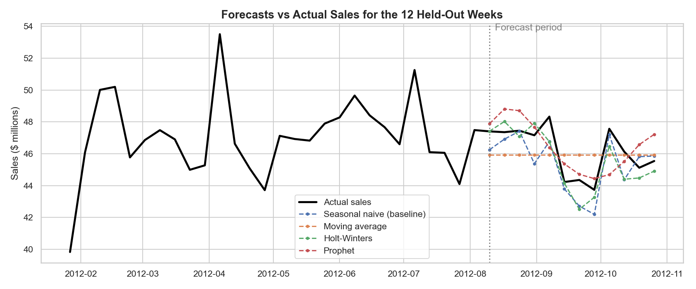
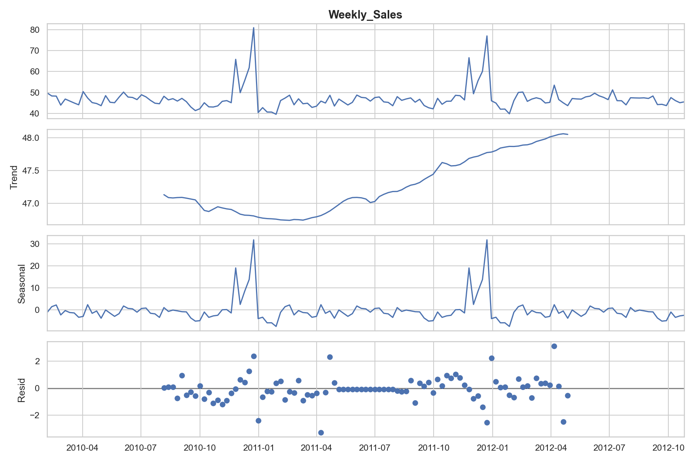

# Walmart Weekly Sales Forecast

Predicting Walmart's total weekly sales 12 weeks ahead so the business can plan inventory and staffing.

**Tools:** Python, pandas, statsmodels, Prophet, matplotlib, seaborn, Jupyter

## Key results

- The **Holt-Winters** model predicted weekly sales within **1.78%** on average, about **$821K** on a typical **$46M** week.
- That is **16% more accurate** than simply copying last year's sales for the same week.
- **Holiday weeks bring 7.8% more sales** than regular weeks, and the weeks right before Christmas are the busiest of the year.
- Gas prices, inflation (CPI) and unemployment had **almost no effect** on sales.

## The data

[Walmart Sales dataset on Kaggle](https://www.kaggle.com/datasets/yasserh/walmart-dataset): weekly sales for 45 stores from February 2010 to October 2012 (about 6,400 rows), with holiday flags, temperature, fuel price, CPI and unemployment.

## Approach

1. **Cleaned the data:** fixed date formats, checked for missing values and duplicates, and added up all 45 stores into one weekly total.
2. **Explored the data:** looked at the overall trend, the yearly seasonal pattern, holiday impact, store performance and economic factors.
3. **Built and compared four forecasting models:** held back the last 12 weeks, trained each model on everything before them, and compared each forecast with actual sales.
4. **Turned the results into business recommendations.**

## Model comparison

| Model | How it works |
|---|---|
| Seasonal naive (baseline) | Next week's sales = the same week last year |
| Moving average | Average of the last 4 weeks, repeated forward |
| **Holt-Winters (best)** | Learns the level, trend and yearly pattern of sales |
| Prophet | Meta's forecasting library, with holidays built in |

Holt-Winters had the lowest error (MAPE 1.78% vs 2.12% for the baseline). Walmart's sales follow a strong, stable yearly pattern, which Holt-Winters is designed to capture. With under three years of history, Prophet's extra flexibility did not improve accuracy. Full results are in [`model_results.csv`](model_results.csv).

## Recommendations

1. **Use the Holt-Winters model to plan inventory and staffing 12 weeks ahead.** Its predictions are off by only about 1.8% a week.
2. **Add staff and stock from late November through December**, when holiday sales peak.
3. **Keep extra backup inventory at stores with unpredictable sales**, since they are the most likely to run out of stock.
4. **Don't plan around gas prices, inflation or unemployment.** These had almost no effect on sales.

## Limitations and next steps

- With less than three years of data, the model has seen only two full holiday seasons.
- The 12-week test period (August to October 2012) does not include the holiday peak.
- Next steps: forecast each store individually, add best-case and worst-case prediction ranges, and retrain weekly as new data arrives.

## How to run it

1. Download `Walmart.csv` from the Kaggle link above and put it in this folder.
2. Install the packages: `pip install -r requirements.txt`
3. Open `walmart_sales_forecast.ipynb` in Jupyter or VS Code and run all cells.

---
**Author:** Bryan Liranzo · [LinkedIn](https://www.linkedin.com/in/bliranzo)
